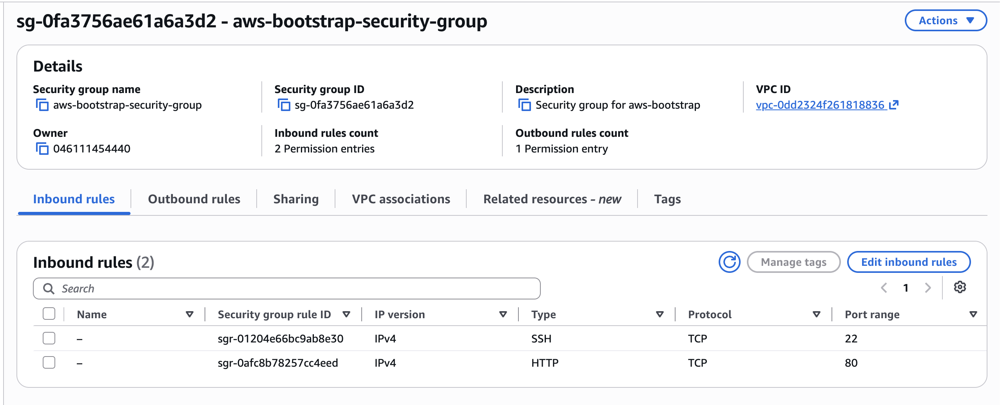
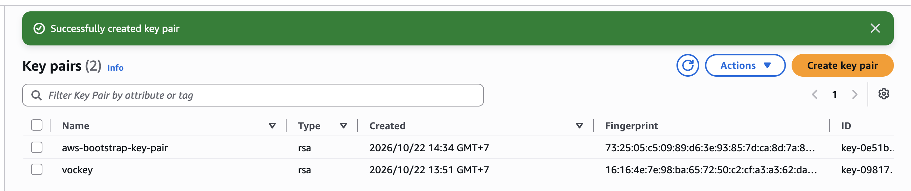
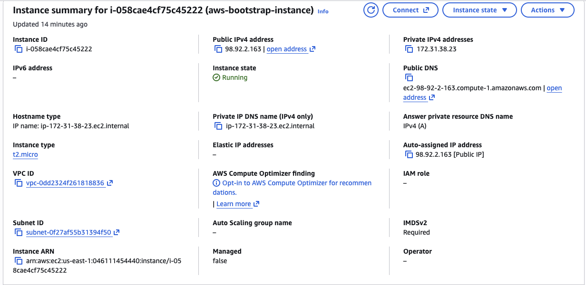
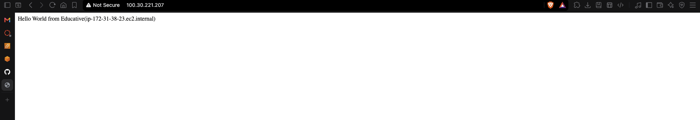
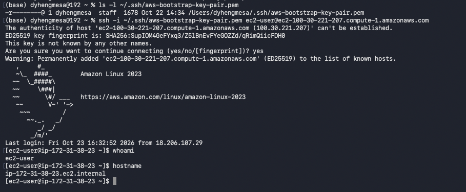
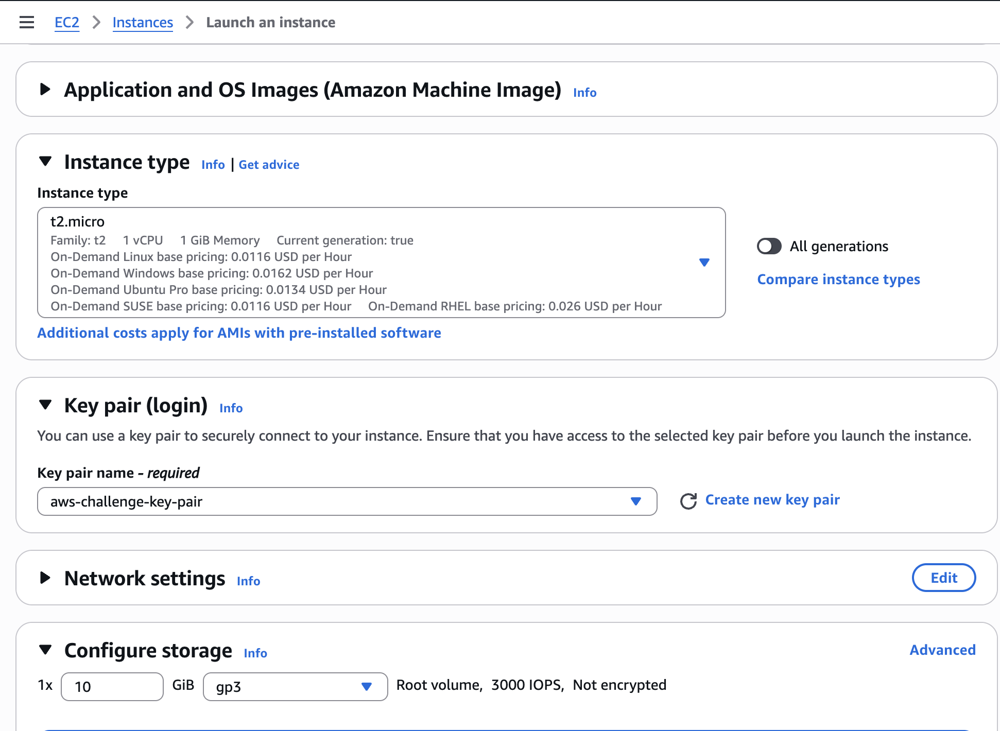
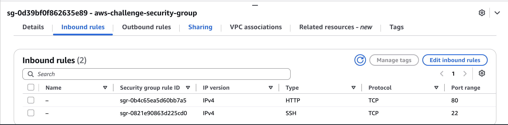
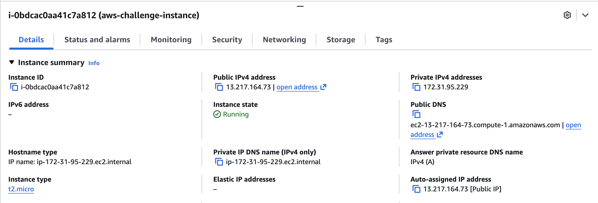
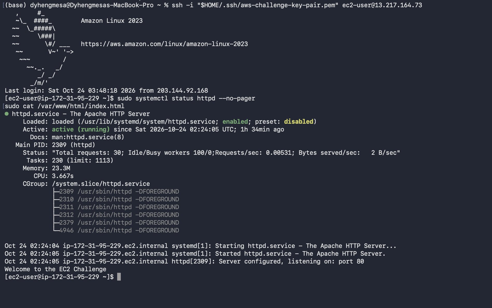
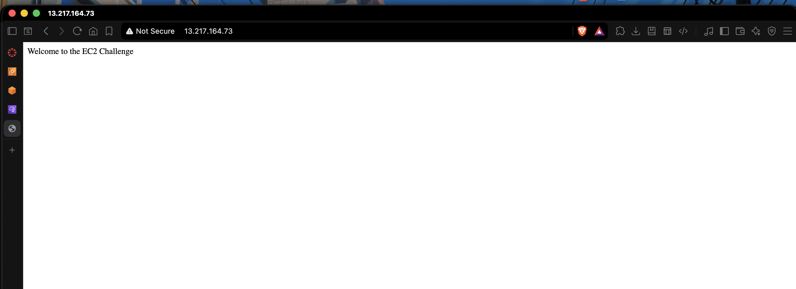

# Cloud Lab 1 Submission — Amazon EC2

Copy this template to `cc-lab-YOUR_ID/lab1/README.md` in your own repository. Follow [the instructions](lab1-instruction.md). Put your screenshots in `lab1/images/` with the file names below.

- **Student name:Hong Dyhengmesa**
- **Student ID:e20220997**
- **Learner Lab user name:voclabs/user5619585=HONG_DYHENGMESA**
- **Date completed:**

---

## Part 1.1 — An Amazon EC2 Walkthrough

### Security group



### Key pair



### Instance details



### Browser test



### SSH connection



Did you connect with your own SSH client or with EC2 Instance Connect?

---

## Part 1.2 — EC2 Web Solution (Challenge)

### Launch configuration



### Security group



### Running instance



### Commands on the instance



Paste the commands you ran to install the web server and create `index.html`:

```bash

```

### Browser test



---

## Questions

1. Your security group has an SSH rule and an HTTP rule. What does each one let you do? What would stop working if you deleted the HTTP rule?
 The SSH rule allows me to connect remotely to my EC2 instance using SSH on TCP port 22. The HTTP rule allows users to access my web server through a browser using HTTP on TCP port 80. If I deleted the HTTP rule, users would not be able to access my website from the internet, even if the Apache web server were running.
2. In Part 1.1 you never logged in to install the web server. What installed it, and when did it run?
The EC2 user data script installed the web server automatically. It ran during the initial startup of the EC2 instance. The script installed Apache, started the web server, and configured it to start automatically.

3. Why does the web page open with `http://` but not with `https://`?
The web server was configured to use HTTP on port 80. HTTPS requires TLS/SSL configuration and a certificate, which were not configured for this lab. Therefore, the webpage is accessible using http:// but not https://.
4. Part 1.2 asked for a 10 GiB root volume. Where in the launch settings did you set it, and how can you check the size on the running instance?
I configured the root volume size as 10 GiB in the Configure storage section when launching the EC2 instance. To check the size of the running instance's root volume, I can select the instance in the AWS EC2 Console, open the Storage tab, and check the attached root EBS volume. It should show a size of 10 GiB.

## Problems and how I solved them (optional)

## AI note (optional)

One suggestion an AI tool gave you and how you checked it.

## Clean up

- [ ] Part 1.1: instance terminated, key pair and security group deleted.
- [ ] Part 1.2: instance terminated, security group (and key pair, if any) deleted.
