# Cloud Lab 2 Submission — Load Balancer and Auto Scaling

Copy this template to `cc-lab-YOUR_ID/lab2/README.md` in your own repository. Follow [the instructions](lab2-instruction.md). Put your screenshots in `lab2/images/` with the file names below.

- **Student name:Hong Dyhengmesa**
- **Student ID: e20220997**
- **Learner Lab user name:voclabs/user5619585=HONG_DYHENGMESA**
- **Date completed:06-Nov-2026**

---

## Security groups

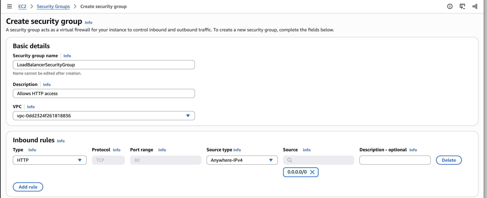

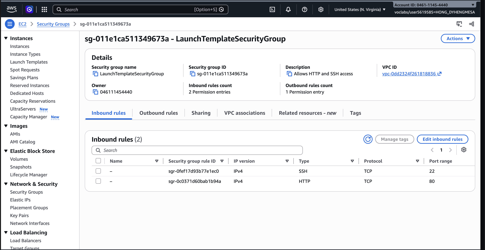

## Target group

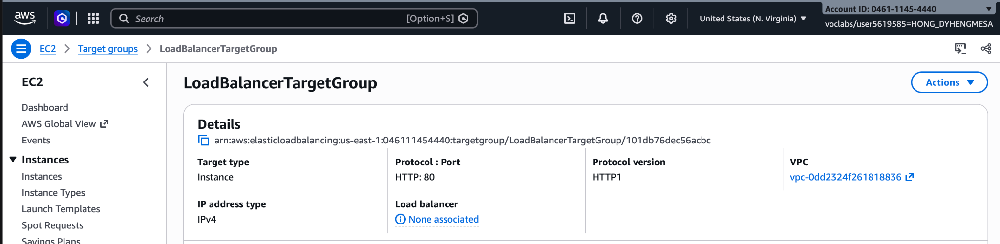

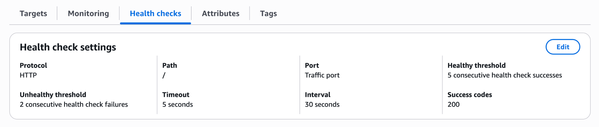

## Application Load Balancer

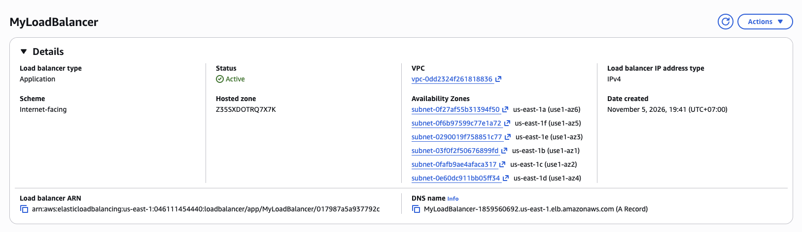

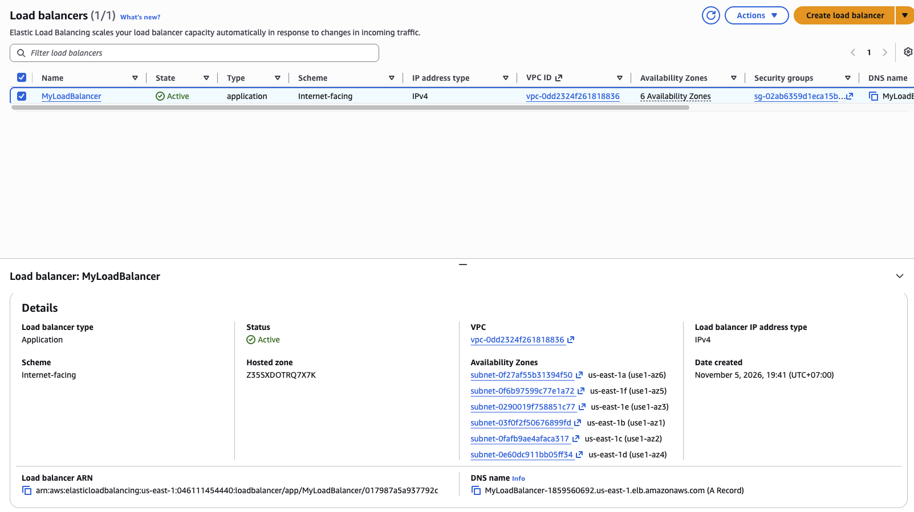

## Launch template

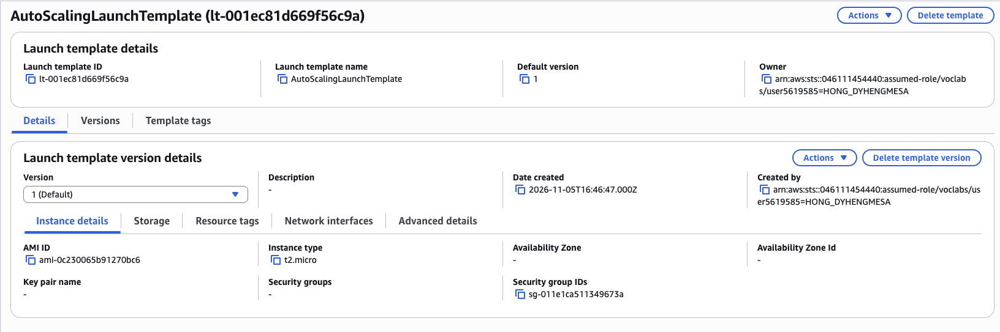

## Auto Scaling group

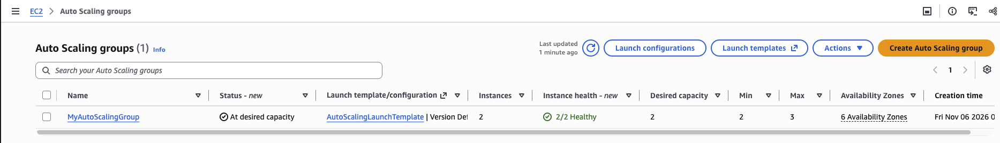

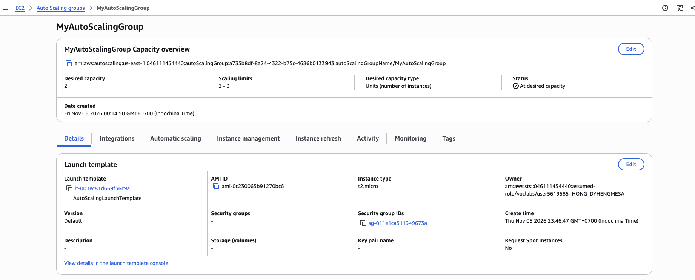

## Load balancing test

## Simulated application failure

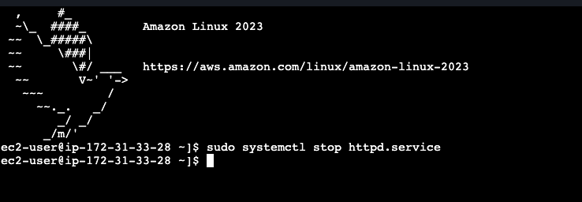

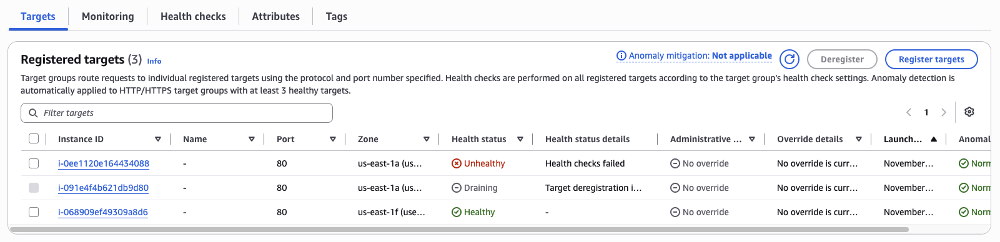

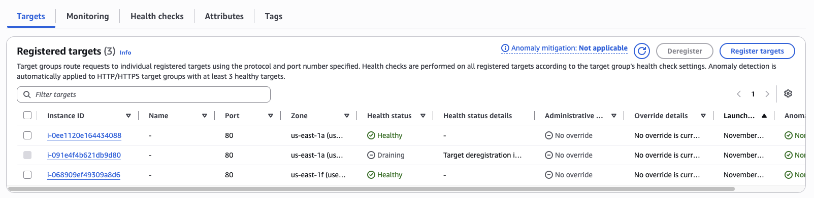

About how many minutes passed between stopping `httpd` and the new instance becoming healthy?

Approximately 2–3 minutes, based on the timestamps of your screenshots. This is an estimate; the exact time depends on when you ran the stop command.

---

## Questions

1. Why does the page show a different host name when you refresh it?

    Because the Application Load Balancer distributes incoming requests between multiple EC2 instances. Each instance has a different host name, so refreshing the page may show a different host name.

2. After you stopped `httpd`, the instance was still *running* in EC2, but the target group marked it *unhealthy*. What did the health check test, and why did the instance fail it?

    The health check tested whether the web server (HTTP service) was responding on port 80. When I stopped httpd, the web server stopped responding to HTTP requests. Therefore, the health check failed, and the target became unhealthy even though the EC2 instance was still running.

3. Who replaced the failed instance: the load balancer, the target group, or the Auto Scaling group? Explain the role of each one.

    The Auto Scaling group replaced the failed instance.
    - Load Balancer: Distributes incoming traffic between healthy instances.
    - Target Group: Monitors instance health using health checks and identifies unhealthy instances.
    - Auto Scaling Group: Maintains the desired number of instances and launches a replacement when an instance becomes unhealthy.

4. With desired 2, minimum 2 and maximum 3, how many instances run normally? In what situation could there be 3?
Normally, 2 instances run because the desired capacity is 2 and the minimum capacity is also 2.

    There could be 3 instances when Auto Scaling temporarily launches a replacement while the unhealthy instance is still being deregistered, or when scaling is triggered by a scaling policy. The maximum capacity is 3.

5. The instances' security group allows HTTP from anywhere. How could you change it so that the instances accept HTTP **only** from the load balancer?

    I would modify the EC2 instances' security group:
    1. Open EC2 → Security Groups.
    2. Select LaunchTemplateSecurityGroup.
    3. Click Edit inbound rules.
    4. Find the HTTP rule (port 80).
    5. Change the source from 0.0.0.0/0 to the security group ID of the load balancer (LoadBalancerSecurityGroup).
    6. Save the rules.

## Problems and how I solved them (optional)

## AI note (optional)

One suggestion an AI tool gave you and how you checked it.

## Clean up

- [ ] `MyAutoScalingGroup` deleted and its instances terminated.
- [ ] `AutoScalingLaunchTemplate` deleted.
- [ ] `MyLoadBalancer` and `LoadBalancerTargetGroup` deleted.
- [ ] Both security groups deleted.