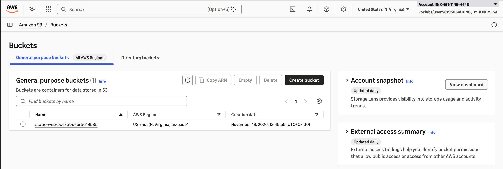
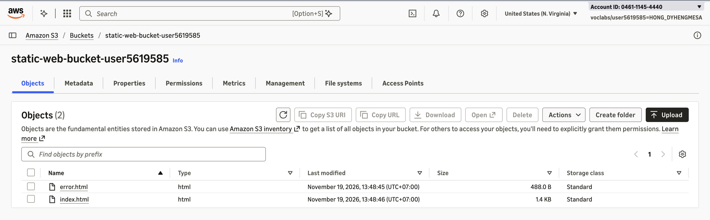
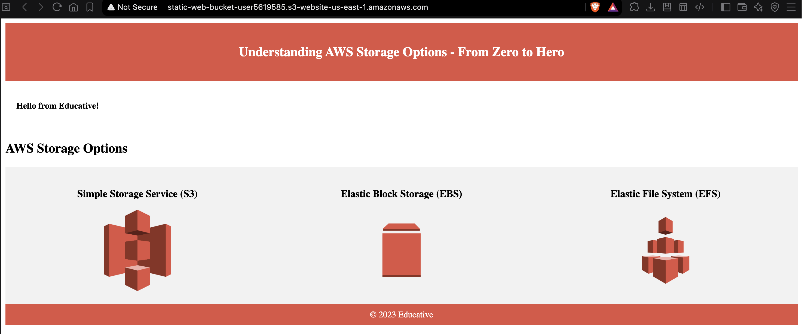
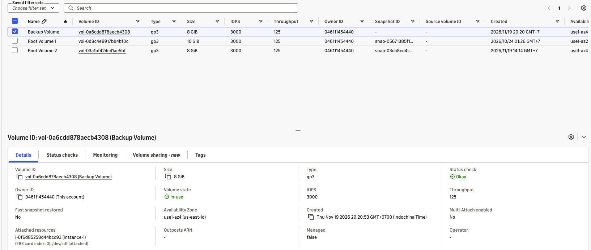
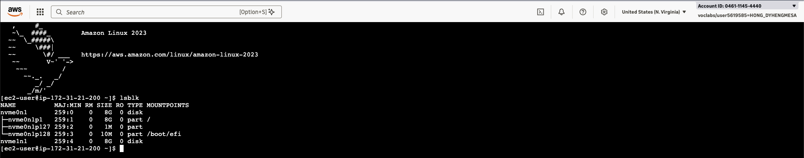
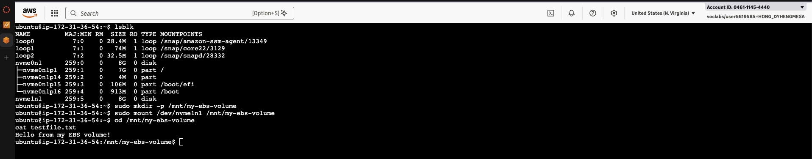
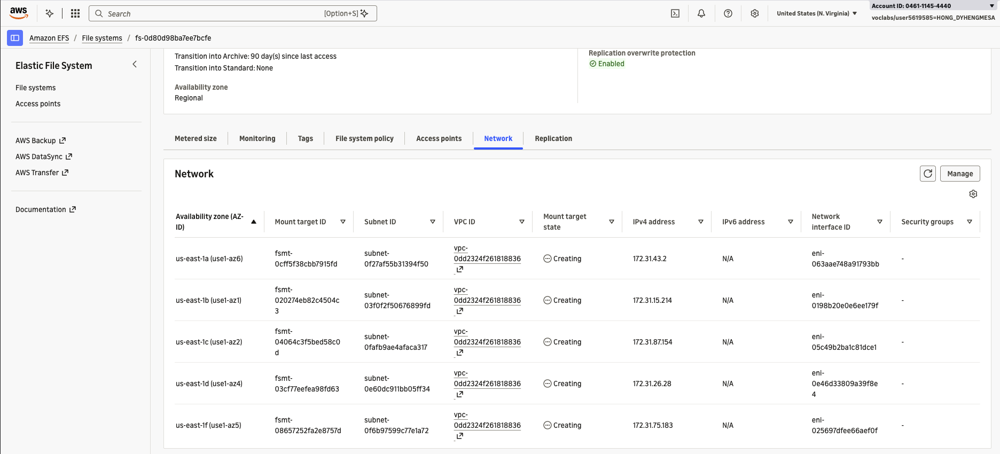
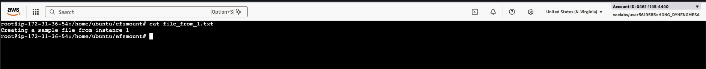
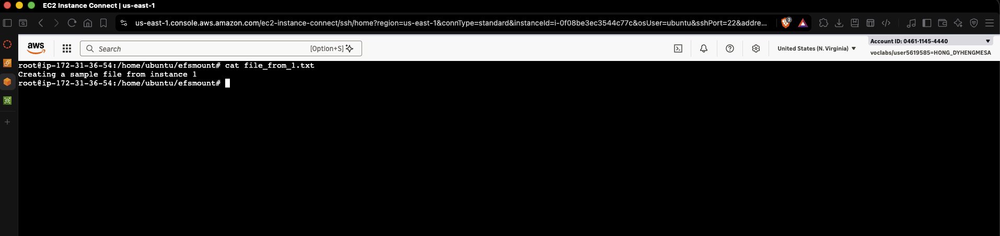

# Cloud Lab 3 Submission — AWS Storage Options

Copy this template to `cc-lab-YOUR_ID/lab3/README.md` in your own repository. Follow [the instructions](lab3-instruction.md). Put your screenshots in `lab3/images/` with the file names below.

- **Student name:Hong Dyhengmesa**
- **Student ID:e20220997**
- **Learner Lab user name:voclabs/user5619585=HONG_DYHENGMESA**
- **Date completed:Fri-20-Nov-2026**

---

## Part 2.1 — Amazon S3

### Bucket list

### Uploaded files

### Static website

---

## Part 2.2 — Amazon EBS

### Volumes page

### Attached volume (`lsblk`)

Which device name did your volume get (`xvdf`, `nvme1n1`, ...)?

### File read on instance-2

---

## Part 2.3 — Amazon EFS

### File system and mount targets

### File created on instance-1

### File listed on instance-3

---

## Questions

1. After you turned on static website hosting, the endpoint first answered **403 Forbidden**. Why, and what changed after you added the bucket policy?

    The website returned 403 Forbidden because public access was not allowed. After adding the bucket policy, visitors could access the website objects.

2. `testfile.txt` was still there after you moved **Backup Volume** to `instance-2`. What would have happened to a file saved on `instance-1`'s **root** volume after terminating `instance-1`?

    A file saved on the root volume would be lost after terminating instance-1 if the root volume was deleted with the instance.

3. Why did you run `mkfs` on `instance-1` but not on `instance-2`?

    We ran mkfs on instance-1 to create a filesystem on the new, empty EBS volume. We did not run it on instance-2 because the volume already had a filesystem and data.

4. Why could `instance-1` and `instance-3` use the EFS file system at the same time, when an EBS volume had to be detached first? Why did they have to be in the subnets of the mount targets?

    EFS supports multiple EC2 instances accessing the same file system at the same time. EBS is attached to one instance at a time in this lab. Instances must be in subnets with EFS mount targets to connect to EFS.

5. For each need, choose S3, EBS or EFS and give one reason: (a) a website's images, (b) the disk of a database server, (c) a folder shared by several web servers.

    (a) Website images: S3 — stores website files and images as objects.
    (b) Database server disk: EBS — provides block storage for the server.
    (c) Shared folder: EFS — allows multiple web servers to access the same files.

## Problems and how I solved them (optional)

## AI note (optional)

One suggestion an AI tool gave you and how you checked it.

## Clean up

- [x] Instances `instance-1`, `instance-2`, `instance-3` terminated.
- [x] `clab-efs` and **Backup Volume** deleted.
- [x] Security groups `efs-sg` and `ec2instances-sg` deleted.
- [x] S3 bucket emptied and deleted.
