# Cloud Lab 4 Submission — Amazon VPC

Copy this template to `cc-lab-YOUR_ID/lab4/README.md` in your own repository. Follow [the instructions](lab4-instruction.md). Put your screenshots in `lab4/images/` with the file names below.

- **Student name:Hong Dyhengmesa**
- **Student ID:e20220997**
- **Learner Lab user name:voclabs/user5619585=HONG_DYHENGMESA**
- **Date completed: 11-Nov-2026**

---

## VPC and internet gateway

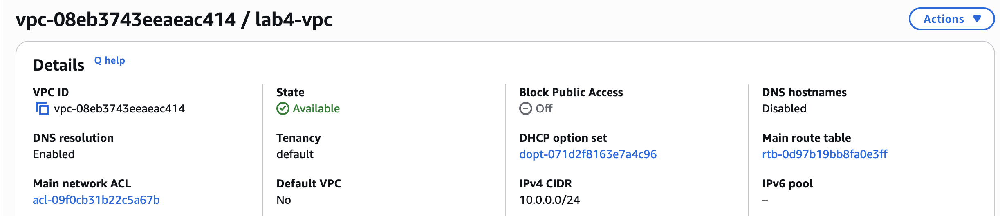

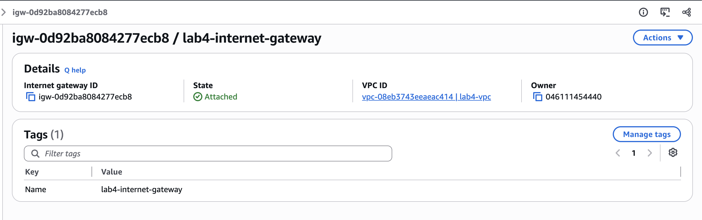

## Public subnet

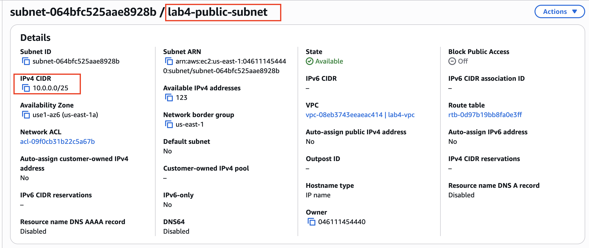

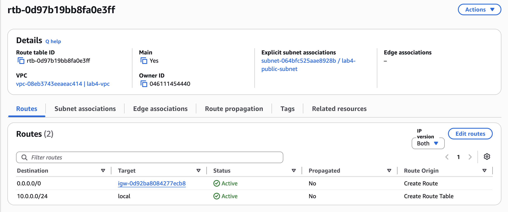

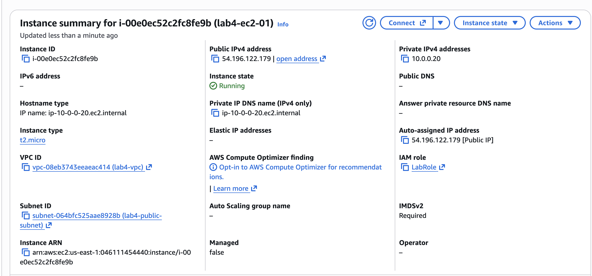

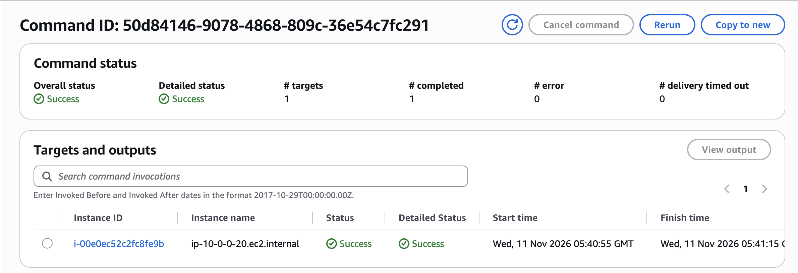

## Private subnet

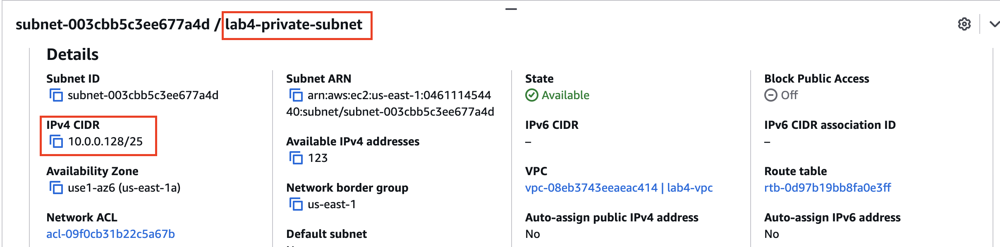

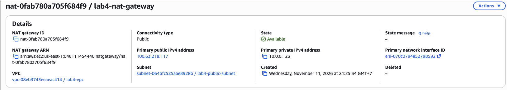

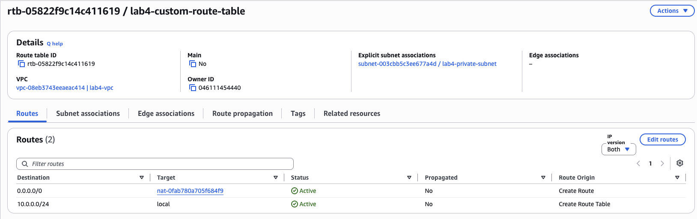

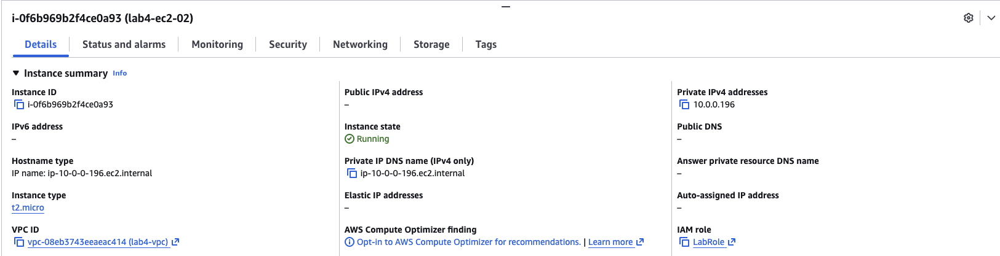

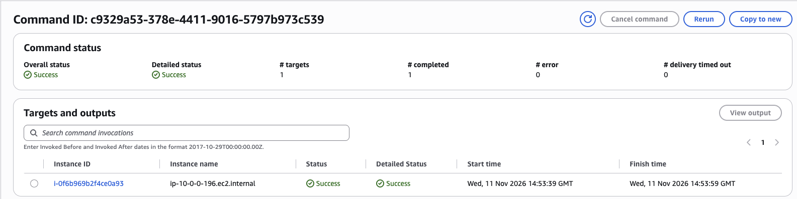

---

## Questions

1. The VPC is `10.0.0.0/24` and the subnets are `10.0.0.0/25` and `10.0.0.128/25`. How many IP addresses does each block contain, and why do the two subnets not overlap?

     The VPC 10.0.0.0/24 contains 256 IP addresses. Each subnet (10.0.0.0/25 and 10.0.0.128/25) contains 128 IP addresses. They do not overlap because they use separate IP address ranges within the VPC.
2. Both subnets are in the same VPC. What exactly makes `lab4-public-subnet` public and `lab4-private-subnet` private?

    The public subnet is public because its route table has a default route (0.0.0.0/0) pointing to the Internet Gateway. The private subnet is private because its default route points to the NAT Gateway instead of directly to the Internet Gateway.
3. Why is the NAT gateway placed in the **public** subnet and not in the private one?

    The NAT Gateway is placed in the public subnet because it needs access to the Internet Gateway to forward internet traffic from private instances. It also uses an Elastic IP address to communicate with the internet.
4. `lab4-ec2-02` has no public IP address. Can someone on the internet open a connection to it? Can it download updates? Explain both answers.

    No, someone on the internet cannot directly connect to the private EC2 because it has no public IP address. However, it can download updates through the NAT Gateway because the NAT Gateway allows private instances to initiate outbound internet connections.
5. You tested internet access with Systems Manager instead of SSH. Why did the instances need `LabInstanceProfile` for this?

The instances need LabInstanceProfile because it provides the IAM permissions required to communicate with AWS Systems Manager. This allows Systems Manager to remotely execute commands on EC2 instances without using SSH.

## Problems and how I solved them (optional)

## AI note (optional)

One suggestion an AI tool gave you and how you checked it.

## Clean up

- [ ] Instances terminated.
- [ ] NAT gateway deleted and its Elastic IP released.
- [ ] Internet gateway detached and deleted.
- [ ] `lab4-vpc` deleted.