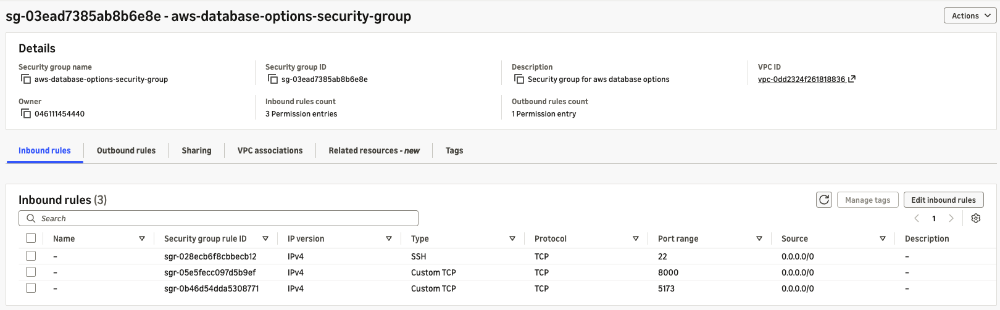
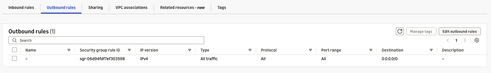
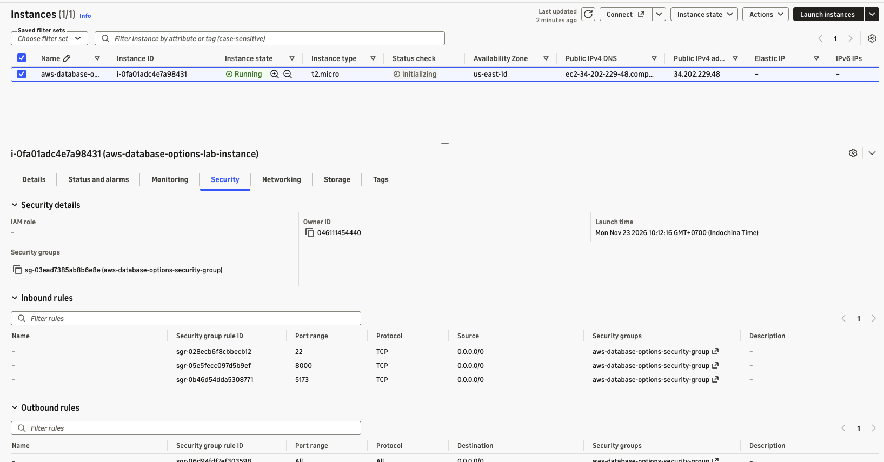
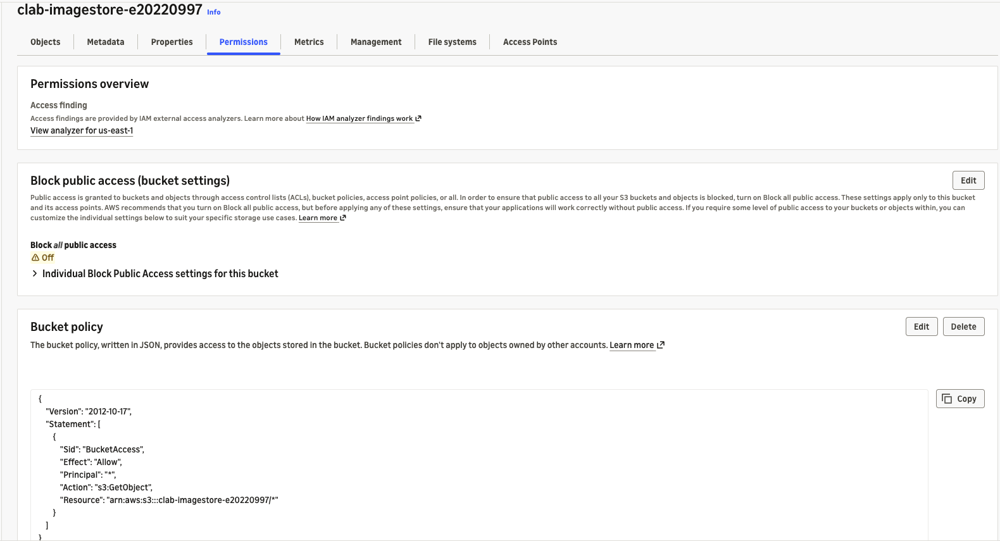
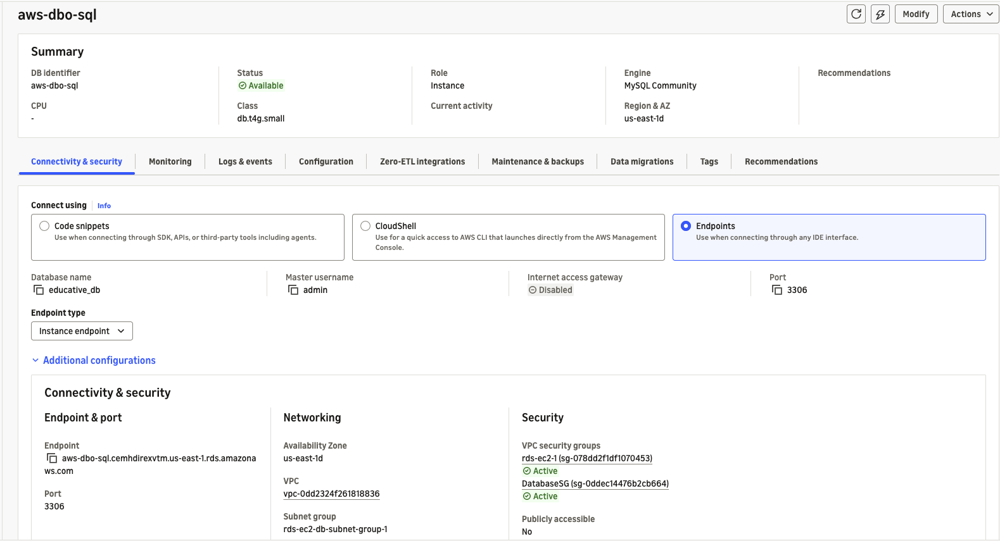
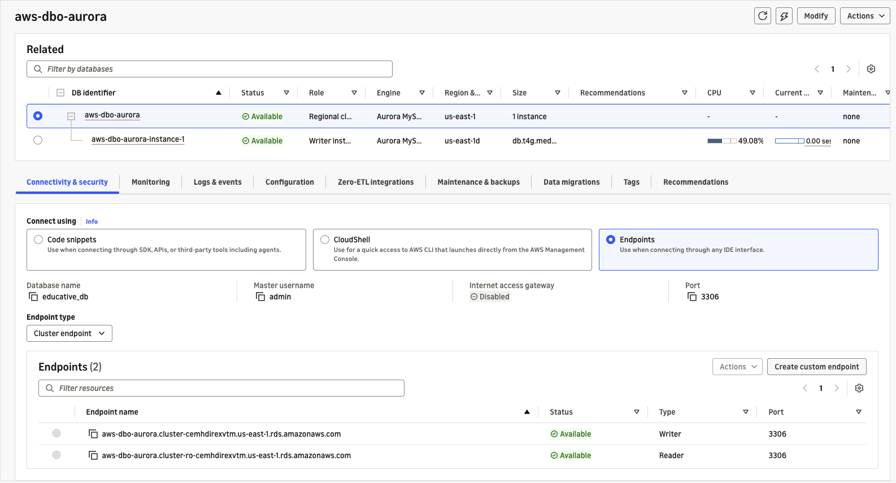
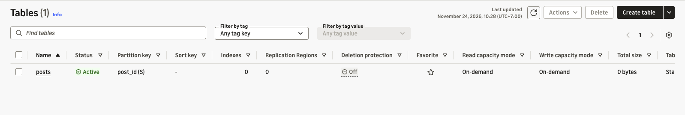
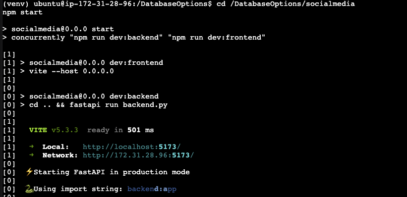
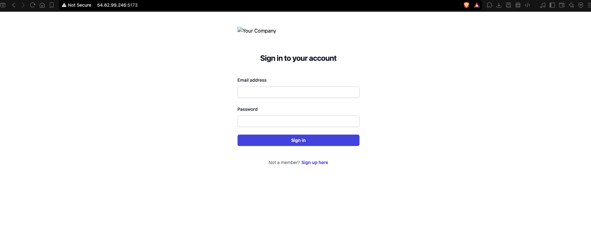
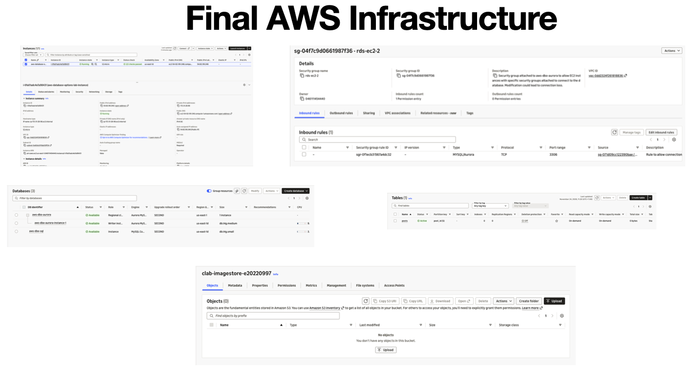

# Cloud Lab 5 Submission — AWS Database Lab

Copy this template to `cc-lab-YOUR_ID/lab5/README.md` in your student repository. Follow [the lab instructions](lab5-instruction.md) and save your screenshots in `lab5/images/` with the file names below. This report is the single document that holds all your screenshots. Each heading labels the screenshot under it.

- **Student name:Hong Dyhengmesa**
- **Student ID:e20220997**
- **Learner Lab user name:voclabs/user5619585=HONG_DYHENGMESA**
- **Date completed:24-Nov-2026**

Make sure resource names, statuses and endpoints are readable in every screenshot. Never show your database passwords or the AWS access key, secret key or session token.

---

## 1. Security Group Rules

`aws-database-options-security-group` with its inbound rules (SSH port 22, Custom TCP ports 8000 and 5173) and its outbound rule.

## 2. EC2 Instance Running

`aws-database-options-lab-instance` in the **Running** state with `aws-database-options-security-group` attached.

## 3. S3 Bucket

Your `clab-imagestore-…` bucket with its public access settings and bucket policy visible.

## 4. RDS DB Instance

`aws-dbo-sql` with the status **Available** and its endpoint visible.

## 5. Aurora DB Status

The `aws-dbo-aurora` cluster with the status **Available** and its writer and reader endpoints visible.

## 6. DynamoDB Table

The `posts` table with the status **Active** and its partition key `post_id` visible.

## 7. Application Configuration and Testing

The EC2 instance terminal after `npm start`, showing that the application started.

The application running in your browser at `http://<Public_IP_of_EC2>:5173`, with the address bar visible.

## 8. Final Infrastructure

One collage of the resources you created: EC2 instance, security group, RDS and Aurora databases, DynamoDB table and S3 bucket.

## Signup and Sample Post (optional)

The signup or login page and a sample post. Delete this section if you did not take this screenshot.

## Errors and troubleshooting (optional)

Screenshots of any error messages you met, and what you did about them.

---

## Questions

1. Signup writes to the Aurora **writer** endpoint and login reads from the **reader** endpoint. Your cluster has no Aurora Replica. Which instance answers the reader endpoint, and why does the application still work?

    Because the Aurora cluster has no Aurora Replica, the writer instance also handles read requests through the reader endpoint.
    The application still works because the reader endpoint can direct read queries to the available writer instance when no replicas exist.

2. A post is split between the `user_post` table in RDS and the `posts` table in DynamoDB. What does each one store, and how does `/get_posts` join them?

    The application stores post information in two different databases:
    - RDS (user_post table): Stores post metadata, such as the post ID and username.
    - DynamoDB (posts table): Stores the actual post content and related post data.

3. The post ID is the username followed by the time (`%H:%M:%S`). What happens if the same user publishes two posts in the same second, or on two different days at the same time?

    The post ID is generated using the username and time in %H:%M:%S format.

    There are two possible problems:
    - Two posts in the same second: Both posts from the same user will generate the same ID.
    - Two posts on different days at the same time: They will also generate the same ID because the date is not included.

4. Why does the post content go into DynamoDB instead of a SQL table, according to the lab's database design?

    DynamoDB is a NoSQL database that can store flexible data without requiring a fixed relational table structure.
    It is suitable for storing post content because posts may contain different types of information, such as text, images, and other attributes.

5. The `users` table stores the password exactly as the user typed it, and the S3 bucket allows anyone to read its objects. Name one risk of each choice.

    There are two security risks:
    1. Plain-text passwords: If attackers access the database, they can read users' passwords directly and use them to access their accounts.
    2. Public S3 bucket: Anyone can access publicly readable objects, which may expose private images or files.

## Clean up

- [x] EC2 instance terminated and `aws-database-options-security-group` deleted.
- [x] RDS instance `aws-dbo-sql` and Aurora cluster `aws-dbo-aurora` deleted.
- [x] S3 bucket emptied and deleted.
- [x] DynamoDB table `posts` deleted.

